  

<h1 align="center">Zodyvel downloads</h1>

<b>Installers and release notes for Zodyvel, the tiny island on top of your Windows screen.</b>

  
  

  
  
  

## ⬇️ Install

1. Open the **[latest release](https://github.com/shadow-lo/zodyvel-releases/releases/latest)**.
2. Download the installer (`.exe`) from **Assets** and run it.
3. Move your mouse to the top center of the screen. The island opens.

Requires Windows 11 (WebView2 is built in). The app updates itself when a new version is published here.

## ✨ What is Zodyvel?

- 🤖 **AI agents:** live Claude Code / Codex status, approve or deny tool requests from the island.
- 🎵 **Music:** whatever plays through Windows media controls.
- 📊 **System load:** CPU, RAM and GPU at a glance.
- 💜 **Zody:** the island's mascot, with glowing eyes that show what is going on.
- 🎮 Hides itself during full-screen games, videos and presentations.

Source code and details: **[shadow-lo/zodyvel](https://github.com/shadow-lo/zodyvel)** (MIT).

---

## 🇹🇷 Türkçe

**Zodyvel**, Windows ekranının üst ortasında yaşayan hafif bir ada: AI ajanlarının durumu ve onayları, çalan müzik, sistem yükü. Maskotu **Zody**.

**Kurulum:**
1. **[Son sürüm](https://github.com/shadow-lo/zodyvel-releases/releases/latest)** sayfasını aç.
2. **Assets** altından kurulum dosyasını (`.exe`) indirip çalıştır.
3. Fareyi ekranın üst ortasına götür, ada açılır.

Windows 11 gerekir. Yeni sürüm burada yayımlanınca uygulama kendini günceller. Kaynak kod: [shadow-lo/zodyvel](https://github.com/shadow-lo/zodyvel).
